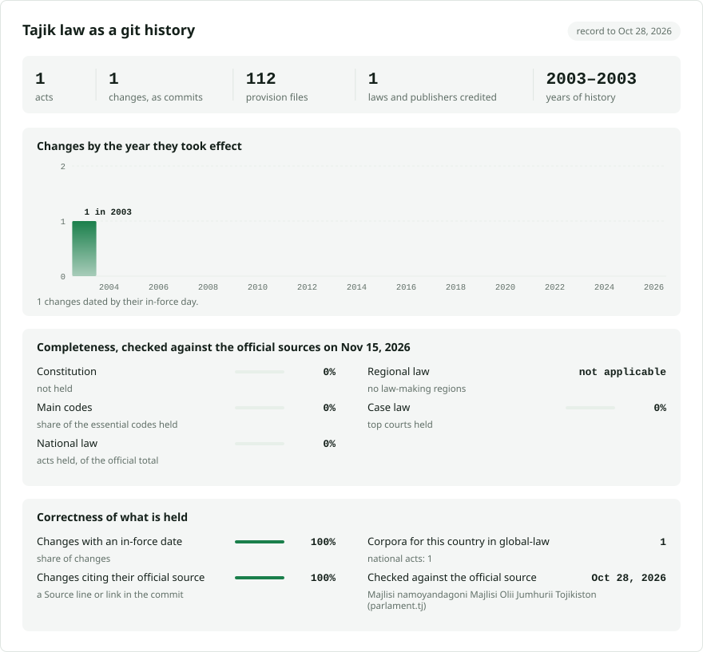

# Tajikistan: law history in git

[Тоҷикӣ](README.md) · **English**

<picture>
<source media="(prefers-color-scheme: dark)" srcset="data/effort-dark.svg">

</picture>

The law of Tajikistan as a git history: one file per article, one commit per version on the day it took effect, and the law that made each change as the commit's author (the publisher, for the oldest version available). `git blame` names the act behind every line; `git log` lists every change to an article; picking a date gives the text in force that day.

Part of [lexifina/global-law](https://github.com/lexifina/global-law), one git history for every country's law: this is Tajikistan's national law, which global-law reads at `tajikistan/national/acts/`.

**What is in it now:** the Constitution in force (2 versions, the 2016 one from president.tj); 19 codes (21 folders: the 2004, 2012 and 2021 Tax Codes are separate), among them the Civil Code (2023), the Criminal Code (2020 and 2025 editions), the Code of Administrative Offences (2025), the Civil, Criminal and Economic Procedure Codes, the Customs, Land and Housing Codes and the Tax Code with 16 editions from 2010 to 2025; 103 laws, including 6 constitutional laws; 40 government resolutions; and 12 ministerial rules. Most codes, laws and resolutions are the consolidated texts the Tax Committee publishes (andoz.tj); later editions of six codes (2024 to 2026: Civil, Civil Procedure, Criminal Procedure, Economic Procedure, Customs, Administrative Offences) and 44 acts, mostly on intellectual property, culture and the media, are secondary copies of the Tajik text from WIPO Lex, marked `Source-status: secondary copy` in their commits. Each is dated by the date its text or WIPO Lex gives. One file per article. The official database (ncz.tj) and the parliament sites do not answer from here. [`REPRODUCE.md`](REPRODUCE.md) says how it was built and what is held.

<!-- adlia -->**From the Ministry of Justice register** (portali-huquqi.tj/publicadliya, the public "Адлия" register of normative legal acts): 4154 more acts in their current editions: 25 codes and constitutional laws, 261 laws in `qonunho/<year>/`, 2674 government resolutions in `qarorhoi-hukumat/<year>/` and `qarorhoi-shuroi-vaziron/<year>/`, 187 presidential decrees and orders in `farmonhoi-prezident/<year>/` and `farmoishhoi-prezident/<year>/`, 345 Majlisi Oli resolutions in `qarorhoi-majlisi-oli/<year>/`, 48 resolutions of the plenums of the Supreme Court and the Supreme Economic Court in `qarorhoi-plenumi-sudi-oli/<year>/` and `qarorhoi-plenumi-sudi-oli-iqtisodi/<year>/`, 25 orders of the Prosecutor General in `farmoishhoi-prokurori-generali/<year>/` and 589 other acts (ministry and agency rules and instructions) in `sanadhoi-digar/<year>/` (the year is the year of adoption), plus 15 newer editions of acts already held. Each is dated by the in-force day the register gives for its edition; 748 acts the register marks as no longer in force are removed on that day. 1359 acts for which the register has no Tajik text are in Russian. Amending acts are not folders of their own: their changes are in the consolidated texts.<!-- /adlia -->

Each act is one folder (`konstitutsiya/` is the Конститутсияи (Сарқонуни) Ҷумҳурии Тоҷикистон, the Constitution), with one file per article (`art-001.md` to `art-100.md`), one per chapter heading (`bob-01.md` to `bob-10.md`), `preamble.md`, and a `README.md` listing them.

The text is in Tajik (Cyrillic), the state language (Article 2 of the Constitution), as the Majlisi namoyandagon published it; the Belarusian letter "ў" the publisher mixes in is written as the Tajik "ӯ". The Russian text is used only for acts the Ministry of Justice register holds in Russian alone; English translations are not part of this record.

## Questions as git commands

| Question | Command |
| --- | --- |
| Every change to Article 37 of the Constitution (the right to rest) | `git log -p --word-diff -- konstitutsiya/art-037.md` |
| Which act wrote each line of Article 37? | `git blame konstitutsiya/art-037.md` |
| Every version of the Constitution, with the day each took effect | `git log --format="%h %(trailers:key=In-force,valueonly,separator=) %an" -- konstitutsiya ":(exclude)konstitutsiya/README.md"` |
| Article 37 as in force on 1 January 2010 | `python tools/on.py 2010-01-01 konstitutsiya art-037` |

**Outside git**, we also host this record publicly, for free:

- **[Ask Claude about the law of Tajikistan](https://global-law.lexifina.com/v1/try_claude?country=tajikistan)**: opens Claude with a first question ready.
- **[Ask ChatGPT](https://global-law.lexifina.com/v1/try_chatgpt?country=tajikistan)**: the same question in ChatGPT.
- **[Search Tajikistan's law on our site](https://lexifina.com/law?country=tajikistan&q=%D1%80%D1%83%D1%85%D1%81%D0%B0%D1%82%D0%B8%D0%B8+%D2%B3%D0%B0%D1%80%D1%81%D0%BE%D0%BB%D0%B0)**: a search for "рухсатии ҳарсола" (annual leave), with each provision's text and its versions, no account needed.
- **[Developer REST API](https://global-law.lexifina.com/v1/search_law?query=%D1%80%D1%83%D1%85%D1%81%D0%B0%D1%82%D0%B8%D0%B8+%D2%B3%D0%B0%D1%80%D1%81%D0%BE%D0%BB%D0%B0&jurisdiction=tajikistan)**: the same search as JSON, with no key. See the [documentation here](https://lexifina.com/api/global-law).

Both assistants read the record through the free Global law connector (MCP, `https://global-law.lexifina.com/mcp`); the first time, the chat gives you the link that adds it. Ask in Tajik or in English.

**Host it yourself easily.** All it takes is git and Python, and the tools run on your machine:

```sh
git clone --depth 1 https://github.com/lexifina/global-law && cd global-law
python3 tools/countries.py add tajikistan/national/acts
python3 tools/law.py show 2010-01-01 tajikistan/national/acts/konstitutsiya/art-037.md
```

Opened in Claude Code, Cursor, VS Code or Codex, the clone also starts a local MCP server with the same tools ([MCP.md](https://github.com/lexifina/global-law/blob/main/MCP.md)).

## Dates

Each commit is dated at noon, Asia/Dushanbe, on the day the version took effect, and carries it in its `In-force:` trailer:

- for the 1999+2003 edition, 22 June 2003, and for the 2016 edition, 22 May 2016: the days of the referendums the sources name. The 2016 amendments took effect on their official publication after the result was announced (Transitional provisions, item 1), a day not found at a source reachable from here; the `In-force-basis:` trailer says so;
- `tools/on.py` picks the version in force on a day by this trailer, not by the commit date.

That version is the "oldest version available", credited to its publisher, the Majlisi namoyandagon of the Majlisi Oli (parlament.tj), not to a law; its commit message names the referendums of 6 November 1994 and 26 September 1999 as having produced the text. Later versions are credited to the law that made each change.

## How it is checked

- The text was compared article by article with a second official copy, the Majlisi milli's (majmilli.tj, Internet Archive capture of 7 March 2018): the same edition, differing only in spelling slips ("Кӯҳистони" and "Куҳистони") and in how numbered lists are laid out. The record keeps the Majlisi namoyandagon text.
- `tools/check_repo.py` reads every version back from git on the day it took effect and on the day before, and compares it with the corpus it was built from. [`REPRODUCE.md`](REPRODUCE.md) gives the corpus's sha256, and does not yet record a run of the check or a second build for it.
- The same check requires every commit's trailers to parse, no merge commits, no commit dates going backwards and nothing dated in the future. History is append-only: no published commit is rewritten.
- [vulnerabilities/](vulnerabilities/README.en.md): possible drafting mistakes in this law, found by global-law's detectors and checked by hand. Not run yet.

## What it does not show

- **Earlier editions and the newest acts.** The Ministry of Justice register gives only the current edition of each act, and its public copy ends in late 2023; the official database ncz.tj and parlament.tj / majmilli.tj time out from here. The Labour and Forest Codes are here only if the register holds them.
- **Earlier texts.** The 1994 original and the 1999 edition are named in the record, but their texts are not here.
- **Any other law**: case law (the Constitutional Court decisions are in the separate tajikistan-caselaw repository), local acts and treaties are not here.
- **The Russian text** of acts that have a Tajik text (Russian is the language of interethnic communication, Article 2).

## Sources

| Source | Kind | Past versions | Notes |
| --- | --- | --- | --- |
| [Majlisi namoyandagon](https://web.archive.org/web/20170607141323/http://parlament.tj/konstitutsiyai-jt/) (lower chamber of the Majlisi Oli, parlament.tj) | Parliament's text of the Constitution | no, one edition | The text of this record, read from the Internet Archive capture of 7 June 2017 |
| [Tax Committee under the Government](https://andoz.tj/Legislation/Laws) (andoz.tj) | Codes, laws and resolutions as PDFs with a text layer | Tax Code: 16 editions 2010-2025; others one edition (Criminal Code two) | Read on 26 November 2026 |
| [Ministry of Justice register of normative legal acts](http://portali-huquqi.tj/publicadliya/) (portali-huquqi.tj, "Адлия") | Current editions of codes, laws, decrees and resolutions, with reference cards (adoption, start of action, edition, lapse) | no, the current edition of each act | Read on 27 November 2026; Tajik, Russian where no Tajik text |
| [President of the Republic of Tajikistan](https://president.tj/) (president.tj) | The Constitution as in force, with the 1999, 2003 and 2016 amendments | no, the current edition | The 2016 version, read on 26 November 2026 |
| Majlisi milli (upper chamber, majmilli.tj) | Parliament's text of the Constitution | no, one edition | A second copy (capture of 7 March 2018), compared article by article |

## Licence

See [`LICENSE`](LICENSE). Official documents of a legislative, administrative or judicial character are not protected by copyright in Tajikistan (Law on Copyright and Related Rights of 13 November 1998, article 7); Lexifina's arrangement, commit messages, tables and tools are dedicated to the public domain under CC0 1.0.

No AI model wrote, translated or corrected legal text, and none runs when the history is built; the scripts were written by Claude Code running Claude Opus 5.5 (see [`REPRODUCE.md`](REPRODUCE.md)).

## Visualisations

- [visualisations/](visualisations/README.en.md): charts drawn from this repository. Not drawn yet.

## More

From [lexifina/global-law](https://github.com/lexifina/global-law):

- [FEATURES.md](https://github.com/lexifina/global-law/blob/main/FEATURES.md): every feature, and what every corpus must support (`git blame`, `law.py`, the MCP tools)
- [FAQ.md](https://github.com/lexifina/global-law/blob/main/FAQ.md): questions and answers · [CONTRIBUTING.md](https://github.com/lexifina/global-law/blob/main/CONTRIBUTING.md): proposing changes · [MCP.md](https://github.com/lexifina/global-law/blob/main/MCP.md): the MCP server · [REPRODUCE.md](https://github.com/lexifina/global-law/blob/main/REPRODUCE.md): how it was built · [CHANGELOG.md](https://github.com/lexifina/global-law/blob/main/CHANGELOG.md)
- [FRESHNESS.md](https://github.com/lexifina/global-law/blob/main/FRESHNESS.md): how current each corpus is · [Monitoring](https://github.com/lexifina/global-law/tree/main/monitoring): whether updates are running · [WATCHING.md](https://github.com/lexifina/global-law/blob/main/WATCHING.md): how each official source is watched for changes
- [performance/](https://github.com/lexifina/global-law/tree/main/performance): how fast the tools are, measured
- [visualisations/](https://github.com/lexifina/global-law/tree/main/visualisations): charts and bridges across the world's law
- [Vulnerabilities](https://github.com/lexifina/global-law/tree/main/vulnerabilities): mistakes in legislation as published
