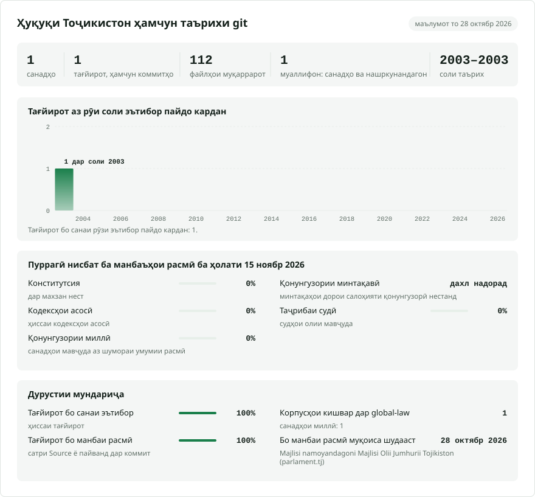

# Тоҷикистон: таърихи қонунгузорӣ дар git

**Тоҷикӣ** · [English](README.en.md)

<picture>
<source media="(prefers-color-scheme: dark)" srcset="data/tg/effort-dark.svg">

</picture>

Қонунгузории Тоҷикистон ҳамчун таърихи git: барои ҳар модда як файл, барои ҳар таҳрир як коммит дар рӯзи эътибор пайдо кардани он, ва муаллифи коммит қонунест, ки тағйиротро ворид кардааст (барои қадимтарин таҳрири дастрас — ношир). `git blame` санадеро, ки паси ҳар сатр аст, номбар мекунад; `git log` ҳамаи тағйироти моддаро нишон медиҳад; бо интихоби сана матне, ки дар он рӯз эътибор дошт, ба даст меояд.

Қисми [lexifina/global-law](https://github.com/lexifina/global-law), ки таърихи ягонаи git барои ҳуқуқи ҳамаи кишварҳост: ин ҳуқуқи миллии Тоҷикистон аст, ки global-law онро аз `tajikistan/national/acts/` мехонад.

**Ҳоло дар он чӣ ҳаст:** Конститутсияи амалкунанда (2 таҳрир, таҳрири соли 2016 аз president.tj); 19 кодекс (21 феҳрист: кодексҳои андози солҳои 2004, 2012 ва 2021 ҷудо), аз ҷумла Кодекси мадании (2023), Кодекси ҷиноятӣ (таҳрирҳои солҳои 2020 ва 2025), Кодекси ҳуқуқвайронкунии маъмурӣ (2025), кодексҳои мурофиавии граждании, ҷиноятӣ ва иқтисодӣ, кодексҳои гумрук, замин ва манзил ва Кодекси андоз бо 16 таҳрир аз соли 2010 то 2025; 103 қонун, аз ҷумла 6 қонуни конститутсионӣ; 40 қарори Ҳукумат; ва 12 қоидаи вазоратӣ. Аксари кодексҳо, қонунҳо ва қарорҳо матнҳои мураттабест, ки Кумитаи андоз нашр мекунад (andoz.tj); таҳрирҳои навтари шаш кодекс (солҳои 2024 то 2026: кодексҳои мадани, мурофиавии граждании, мурофиавии ҷиноятӣ, мурофиавии иқтисодӣ, гумрук ва ҳуқуқвайронкунии маъмурӣ) ва 44 санад, асосан оид ба моликияти зеҳнӣ, фарҳанг ва воситаҳои ахбори омма, нусхаҳои дуюмдараҷаи матни тоҷикӣ аз WIPO Lex мебошанд, ки дар коммитҳояшон бо `Source-status: secondary copy` қайд шудаанд. Ҳар яке бо санае, ки матнаш ё WIPO Lex медиҳад, сана гузошта шудааст. Барои ҳар модда як файл. Махзани расмии санадҳо (ncz.tj) ва сомонаҳои парлумон аз ин ҷо ҷавоб намедиҳанд. [`REPRODUCE.md`](REPRODUCE.md) мегӯяд, ки он чӣ тавр сохта шудааст ва чӣ нигоҳ дошта шудааст.

<!-- adlia -->**Аз Феҳристи Вазорати адлия** (portali-huquqi.tj/publicadliya, феҳристи ошкорои санадҳои меъёрии ҳуқуқии «Адлия»): боз 4154 санад дар таҳрири ҷорӣ: 25 кодекс ва қонуни конститутсионӣ, 261 қонун дар `qonunho/<сол>/`, 2674 қарори Ҳукумат дар `qarorhoi-hukumat/<сол>/` ва `qarorhoi-shuroi-vaziron/<сол>/`, 187 фармон ва фармоиши Президент дар `farmonhoi-prezident/<сол>/` ва `farmoishhoi-prezident/<сол>/`, 345 қарори Маҷлиси Олӣ дар `qarorhoi-majlisi-oli/<сол>/`, 48 қарори Пленуми Суди Олӣ ва Суди Олии иқтисодӣ дар `qarorhoi-plenumi-sudi-oli/<сол>/` ва `qarorhoi-plenumi-sudi-oli-iqtisodi/<сол>/`, 25 фармоиши Прокурори генералӣ дар `farmoishhoi-prokurori-generali/<сол>/` ва 589 санади дигар (қоидаҳо ва дастурҳои вазоратҳо ва идораҳо) дар `sanadhoi-digar/<сол>/` (сол — соли қабул), инчунин 15 таҳрири навтари санадҳое, ки аллакай ҳастанд. Ҳар яке бо рӯзи эътибор пайдо кардани таҳрираш, ки феҳрист медиҳад, сана гузошта шудааст; 748 санаде, ки феҳрист эътибор надошташон медонад, дар он рӯз хориҷ карда мешаванд. 1359 санад, ки дар феҳрист матни тоҷикӣ надоранд, бо забони русӣ оварда шудаанд. Санадҳои тағйирдиҳанда ҷузвдони алоҳида надоранд: тағйироташон дар матнҳои мураттаб аст.<!-- /adlia -->

Ҳар санад як ҷузвдон аст (`konstitutsiya/` — Конститутсияи (Сарқонуни) Ҷумҳурии Тоҷикистон), ки дар он барои ҳар модда як файл (`art-001.md` то `art-100.md`), барои ҳар унвони боб як файл (`bob-01.md` то `bob-10.md`), `preamble.md` ва `README.md` бо рӯйхати онҳо ҳаст.

Матн бо забони тоҷикӣ (бо хатти кириллӣ), ки забони давлатӣ аст (моддаи 2 Конститутсия), ба тавре ки Маҷлиси намояндагон нашр кардааст, оварда шудааст; ҳарфи белорусии «ў», ки ношир дар матн омехта кардааст, ҳамчун ҳарфи тоҷикии «ӯ» навишта шудааст. Матни русӣ танҳо барои санадҳое оварда мешавад, ки дар феҳристи Вазорати адлия танҳо бо русӣ ҳастанд; тарҷумаи англисӣ ба ин сабт дохил намешавад.

## Саволҳо ҳамчун фармонҳои git

| Савол | Фармон |
| --- | --- |
| Ҳамаи тағйироти моддаи 37 Конститутсия (ҳуқуқ ба истироҳат) | `git log -p --word-diff -- konstitutsiya/art-037.md` |
| Ҳар сатри моддаи 37-ро кадом санад навиштааст? | `git blame konstitutsiya/art-037.md` |
| Ҳамаи таҳрирҳои Конститутсия бо рӯзи эътибор пайдо кардани ҳар яке | `git log --format="%h %(trailers:key=In-force,valueonly,separator=) %an" -- konstitutsiya ":(exclude)konstitutsiya/README.md"` |
| Моддаи 37 дар таҳрире, ки 1 январи соли 2010 эътибор дошт | `python tools/on.py 2010-01-01 konstitutsiya art-037` |

**Берун аз git** мо ин сабтро ройгон ва ба таври оммавӣ низ ҷойгир мекунем:

- **[Аз Claude дар бораи ҳуқуқи Тоҷикистон пурсед](https://global-law.lexifina.com/v1/try_claude?country=tajikistan)**: Claude-ро бо саволи аввали тайёр мекушояд.
- **[Аз ChatGPT пурсед](https://global-law.lexifina.com/v1/try_chatgpt?country=tajikistan)**: ҳамон савол дар ChatGPT.
- **[Ҷустуҷӯи ҳуқуқи Тоҷикистон дар сомонаи мо](https://lexifina.com/law?country=tajikistan&q=%D1%80%D1%83%D1%85%D1%81%D0%B0%D1%82%D0%B8%D0%B8+%D2%B3%D0%B0%D1%80%D1%81%D0%BE%D0%BB%D0%B0)**: ҷустуҷӯи «рухсатии ҳарсола» бо матни ҳар муқаррарот ва таҳрирҳои он, бе ҳисоби корбарӣ.
- **[REST API барои барномасозон](https://global-law.lexifina.com/v1/search_law?query=%D1%80%D1%83%D1%85%D1%81%D0%B0%D1%82%D0%B8%D0%B8+%D2%B3%D0%B0%D1%80%D1%81%D0%BE%D0%BB%D0%B0&jurisdiction=tajikistan)**: ҳамон ҷустуҷӯ дар шакли JSON, бе калид. [Ҳуҷҷатгузориро дар ин ҷо](https://lexifina.com/api/global-law) бинед.

Ҳар ду ёрдамчӣ сабтро тавассути пайвасткунандаи ройгони Global law (MCP, `https://global-law.lexifina.com/mcp`) мехонанд; бори аввал чат ба шумо истинодеро медиҳад, ки онро илова мекунад. Бо забони тоҷикӣ ё англисӣ пурсед.

**Онро ба осонӣ худатон ҷойгир кунед.** Танҳо git ва Python лозим аст, ва абзорҳо дар компютери шумо кор мекунанд:

```sh
git clone --depth 1 https://github.com/lexifina/global-law && cd global-law
python3 tools/countries.py add tajikistan/national/acts
python3 tools/law.py show 2010-01-01 tajikistan/national/acts/konstitutsiya/art-037.md
```

Агар клон дар Claude Code, Cursor, VS Code ё Codex кушода шавад, он инчунин сервери маҳаллии MCP-ро бо ҳамон абзорҳо оғоз мекунад ([MCP.md](https://github.com/lexifina/global-law/blob/main/MCP.md)).

## Санаҳо

Ҳар коммит бо нисфирӯзии рӯзи эътибор пайдо кардани таҳрир аз рӯи вақти Asia/Dushanbe сана гузошта шудааст ва ин рӯзро дар трейлери `In-force:` дорад:

- барои таҳрири солҳои 1999 ва 2003 — 22 июни соли 2003, барои таҳрири соли 2016 — 22 майи соли 2016: рӯзҳои раъйпурсиҳое, ки манбаъҳо номбар мекунанд. Тағйиру иловаҳои соли 2016 аз рӯзи интишори расмиашон пас аз эълони натиҷаи раъйпурсӣ эътибор пайдо карданд (Муқаррароти интиқолӣ, банди 1); ин рӯз дар манбаи дастрас ёфт нашуд ва трейлери `In-force-basis:` инро мегӯяд;
- `tools/on.py` таҳрири дар рӯзи додашуда амалкунандаро аз рӯи ҳамин трейлер интихоб мекунад, на аз рӯи санаи коммит.

Ин таҳрир «қадимтарин таҳрири дастрас» (oldest version available) аст ва ба ношираш — Маҷлиси намояндагони Маҷлиси Олӣ (parlament.tj) — нисбат дода шудааст, на ба ягон қонун; паёми коммити он раъйпурсиҳои 6 ноябри соли 1994 ва 26 сентябри соли 1999-ро ҳамчун манбаи пайдоиши матн номбар мекунад. Таҳрирҳои минбаъда ба қонуне нисбат дода мешаванд, ки ҳар тағйиротро ворид кардааст.

## Чӣ тавр санҷида мешавад

- Матн модда ба модда бо нусхаи дуюми расмӣ — нусхаи Маҷлиси миллӣ (majmilli.tj, нусхаи Internet Archive аз 7 марти соли 2018) — муқоиса карда шуд: ҳамон таҳрир, ки танҳо бо хатоҳои имлоӣ («Кӯҳистони» ва «Куҳистони») ва тарзи ҷойгиркунии рӯйхатҳои рақамдор фарқ мекунад. Сабт матни Маҷлиси намояндагонро нигоҳ медорад.
- `tools/check_repo.py` ҳар таҳрирро аз git дар рӯзи эътибор пайдо кардани он ва дар рӯзи пеш аз он бозхонӣ мекунад ва бо корпусе, ки аз он сохта шудааст, муқоиса мекунад. [`REPRODUCE.md`](REPRODUCE.md) sha256-и корпусро медиҳад, вале ҳоло иҷрои ин санҷиш ё сохтани дуюмро барои он қайд накардааст.
- Ҳамин санҷиш талаб мекунад, ки трейлерҳои ҳар коммит таҳлил шаванд, коммитҳои муттаҳидсозӣ (merge) набошанд, санаҳои коммитҳо ба қафо нараванд ва ҳеҷ чиз бо санаи оянда набошад. Таърих танҳо илова карда мешавад: ҳеҷ коммити нашршуда аз нав навишта намешавад.
- [vulnerabilities/](vulnerabilities/): хатоҳои эҳтимолии таҳрир дар ин ҳуқуқ, ки детекторҳои global-law меёбанд ва дастӣ санҷида мешаванд. Ҳоло иҷро нашудааст.

## Он чи нишон дода намешавад

- **Таҳрирҳои пештара ва санадҳои навтарин.** Феҳристи Вазорати адлия танҳо таҳрири ҷории ҳар санадро медиҳад ва нусхаи ошкорои он охири соли 2023 ба охир мерасад; махзани расмии ncz.tj ва parlament.tj / majmilli.tj аз ин ҷо ҷавоб намедиҳанд.
- **Матнҳои пештара.** Матни аслии соли 1994 ва таҳрири соли 1999 дар сабт номбар шудаанд, вале матнҳои онҳо дар ин ҷо нестанд.
- **Ягон қонуни дигар**: таҷрибаи судӣ, санадҳои маҳаллӣ ва шартномаҳои байналмилалӣ дар ин ҷо нестанд.
- **Матни русии** санадҳое, ки матни тоҷикӣ доранд (забони муоширати байни миллатҳо, моддаи 2).

## Манбаъҳо

| Манбаъ | Навъ | Таҳрирҳои пештара | Эзоҳҳо |
| --- | --- | --- | --- |
| [Маҷлиси намояндагон](https://web.archive.org/web/20170607141323/http://parlament.tj/konstitutsiyai-jt/) (палатаи поёнии Маҷлиси Олӣ, parlament.tj) | Матни Конститутсия аз парламент | не, як таҳрир | Матни ин сабт, ки аз нусхаи Internet Archive аз 7 июни соли 2017 хонда шудааст |
| [Кумитаи андози назди Ҳукумат](https://andoz.tj/Legislation/Laws) (andoz.tj) | Кодексҳо, қонунҳо ва қарорҳо ҳамчун PDF бо қабати матн | Кодекси андоз: 16 таҳрир 2010-2025; дигарон як таҳрир (Кодекси ҷиноятӣ ду) | 26 ноябри соли 2026 хонда шуд |
| [Феҳристи санадҳои меъёрии ҳуқуқии Вазорати адлия](http://portali-huquqi.tj/publicadliya/) (portali-huquqi.tj, «Адлия») | Таҳрири ҷории кодексҳо, қонунҳо, фармонҳо ва қарорҳо бо маълумотнома (қабул, оғози амал, таҳрир, аз эътибор соқит шудан) | не, таҳрири ҷории ҳар санад | 27 ноябри соли 2026 хонда шуд; тоҷикӣ, русӣ дар ҷое, ки матни тоҷикӣ нест |
| [Президенти Ҷумҳурии Тоҷикистон](https://president.tj/) (president.tj) | Конститутсияи амалкунанда бо тағйиру иловаҳои солҳои 1999, 2003 ва 2016 | не, таҳрири ҷорӣ | Таҳрири соли 2016, ки 26 ноябри соли 2026 хонда шуд |
| Маҷлиси миллӣ (палатаи болоӣ, majmilli.tj) | Матни Конститутсия аз парламент | не, як таҳрир | Нусхаи дуюм (нусхаи аз 7 марти соли 2018), ки модда ба модда муқоиса карда шуд |

## Иҷозатнома

Нигаред ба [`LICENSE`](LICENSE). Дар Тоҷикистон ҳуҷҷатҳои расмии дорои хусусияти қонунгузорӣ, маъмурӣ ё судӣ бо ҳуқуқи муаллиф ҳифз карда намешаванд (Қонуни Ҷумҳурии Тоҷикистон «Дар бораи ҳуқуқи муаллиф ва ҳуқуқҳои вобаста» аз 13 ноябри соли 1998, моддаи 7); тартиб, паёмҳои коммитҳо, ҷадвалҳо ва абзорҳои Lexifina тибқи CC0 1.0 ба мулки ҷамъиятӣ бахшида шудаанд.

Ҳеҷ модели зеҳни сунъӣ матни ҳуқуқиро нанавиштааст, тарҷума накардааст ва ислоҳ накардааст, ва ҳангоми сохтани таърих ҳеҷ кадоми онҳо кор намекунад; скриптҳоро Claude Code бо модели Claude Opus 5.5 навиштааст (нигаред ба [`REPRODUCE.md`](REPRODUCE.md)).

Ин матн тарҷумаи нусхаи англисӣ ([README.en.md](README.en.md)) аст; дар сурати тафовут нусхаи англисӣ бартарӣ дорад.

## Визуализатсияҳо

- [visualisations/](visualisations/): диаграммаҳое, ки аз ин махзан кашида мешаванд. Ҳоло кашида нашудаанд.

## Маълумоти бештар

Аз махзани [lexifina/global-law](https://github.com/lexifina/global-law) (саҳифаҳо ба забони англисӣ):

- [FEATURES.md](https://github.com/lexifina/global-law/blob/main/FEATURES.md): ҳамаи имкониятҳо ва он чи ҳар корпус бояд дастгирӣ кунад (`git blame`, `law.py`, абзорҳои MCP)
- [FAQ.md](https://github.com/lexifina/global-law/blob/main/FAQ.md): саволу ҷавоб · [CONTRIBUTING.md](https://github.com/lexifina/global-law/blob/main/CONTRIBUTING.md): пешниҳоди тағйирот · [MCP.md](https://github.com/lexifina/global-law/blob/main/MCP.md): сервери MCP · [REPRODUCE.md](https://github.com/lexifina/global-law/blob/main/REPRODUCE.md): чӣ тавр сохта шудааст · [CHANGELOG.md](https://github.com/lexifina/global-law/blob/main/CHANGELOG.md)
- [FRESHNESS.md](https://github.com/lexifina/global-law/blob/main/FRESHNESS.md): ҳар корпус то чӣ андоза нав аст · [Мониторинг](https://github.com/lexifina/global-law/tree/main/monitoring): оё навсозиҳо кор мекунанд · [WATCHING.md](https://github.com/lexifina/global-law/blob/main/WATCHING.md): ҳар манбаи расмӣ барои тағйирот чӣ гуна пайгирӣ мешавад
- [performance/](https://github.com/lexifina/global-law/tree/main/performance): суръати абзорҳо, ченкардашуда
- [visualisations/](https://github.com/lexifina/global-law/tree/main/visualisations): диаграммаҳо ва пайвандҳо дар ҳуқуқи ҷаҳон
- [Осебпазириҳо](https://github.com/lexifina/global-law/tree/main/vulnerabilities): хатоҳо дар қонунгузорӣ, чунон ки нашр шудааст
